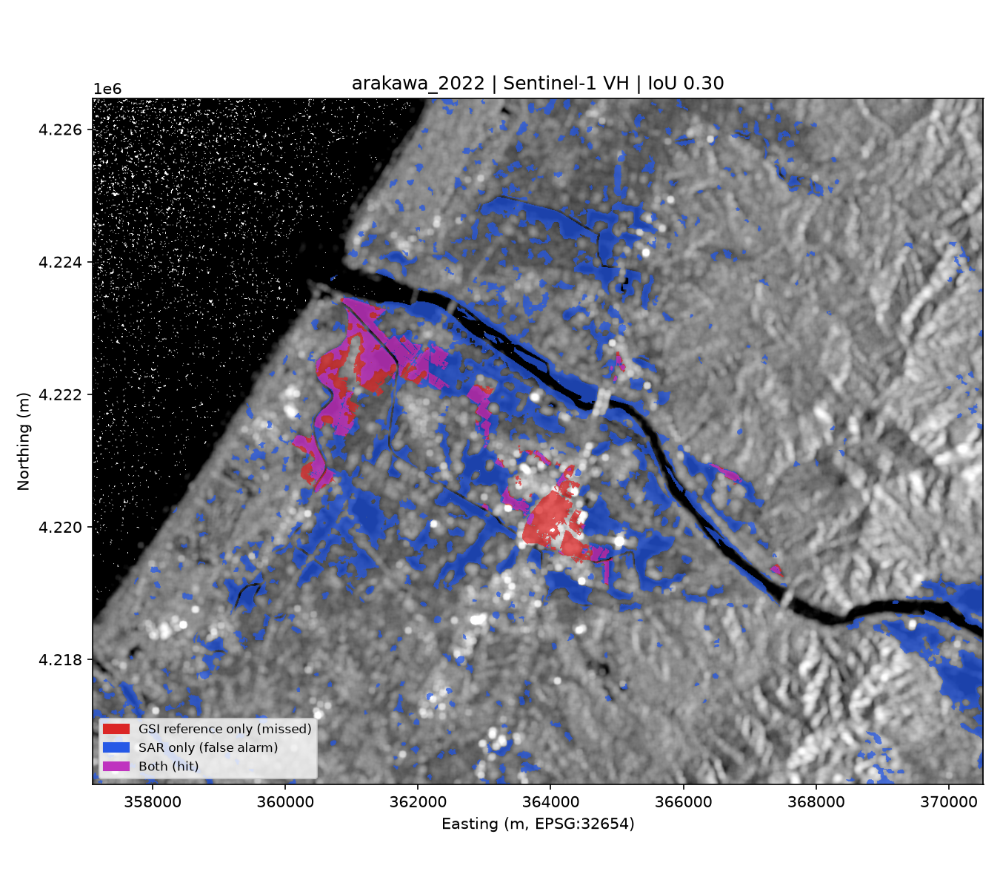

# SAR Flood Mapping in Python — Arakawa River, August 2022

Flood extent mapping from Sentinel-1 radar for the August 2022 Arakawa River flood
(Murakami / Sakamachi, Niigata), validated pixel-by-pixel against the GSI
(Geospatial Information Authority of Japan) inundation estimate.

This is a Python port of my earlier [Google Earth Engine version](#relation-to-the-gee-version).
The science is the same; the point of this repo is the engineering: open data access,
explicit raster alignment, tested functions, and outputs a GIS user can consume.

## Why radar

Heavy cloud covered the flood, so optical imagery was blind. Radar sees through cloud.
Calm floodwater reflects the radar pulse away from the satellite (specular reflection),
so flooded land turns dark between a before and an after image.

## Method

| Step | What | Where |
|---|---|---|
| 1. Data | Sentinel-1 IW GRD, VH and VV, descending relative orbit 46, sigma0 (ellipsoid), before 22 Jul / after 3 Aug 2022 | `acquire.py` (openEO, Copernicus Data Space) |
| 2. Grid | All layers resampled onto one 10 m UTM 54N grid framed by the GSI reference + 3 km | `grid.py` (rasterio `WarpedVRT`) |
| 3. Speckle filter | 50 m circular boxcar in linear power (UN-SPIDER), or Lee filter | `preprocess.py` (NumPy/SciPy) |
| 4. Change detection | before / after ratio > threshold = backscatter dropped | `detect.py` |
| 5. Permanent water | OSM water polygons ∪ JRC Global Surface Water (≥ 10 months/yr) | `masks.py`, `grid.rasterize_vector` |
| 6. Terrain | HAND (height above nearest drainage) < 15 m, from Copernicus DEM | `masks.py` |
| 7. Clean-up | remove patches ≤ 20 connected pixels | `masks.py` (`scipy.ndimage.label`) |
| 8. Validation | IoU, precision, recall vs GSI inside reference + 300 m; recall by ESA WorldCover class | `evaluate.py` |
| 9. Outputs | flood GeoTIFF, flood polygons (GeoPackage), change-ratio GeoTIFF, metrics CSV, quick-look map | `export.py` |

Every parameter is in [`config/arakawa_2022.yaml`](config/arakawa_2022.yaml), so an
experiment is a config change, and each run saves the exact config it used.

## Run it

```bash
conda env create -f environment.yml
conda activate sarflood

python -m sarflood download --config config/arakawa_2022.yaml   # once; cached in data/raw/
python -m sarflood run      --config config/arakawa_2022.yaml
pytest                                                          # 28 tests, synthetic data, ~3 s
```

`download` needs a free [Copernicus Data Space](https://dataspace.copernicus.eu) account
(browser login on first use). Ancillary layers come from Microsoft Planetary Computer
without an account. The pipeline itself only reads local GeoTIFFs in `data/raw/`, so any
other source with the same file names (e.g. a GEE export, in dB or linear) works too.

## Results

Pixel-wise comparison with the GSI survey (inside GSI extent + 300 m), threshold 1.15:

| | IoU | Precision | Recall | Cropland recall | Built-up recall |
|---|---|---|---|---|---|
| **VH** (Python) | 0.296 | 0.385 | 0.562 | 72.8 % | 8.3 % |
| VV (Python) | 0.251 | 0.409 | 0.393 | 53.0 % | 2.8 % |
| VH (earlier GEE run) | 0.30 | 0.41 | 0.52 | 71.9 % | 7.6 % |

The Python port reproduces the GEE result to within a few hundredths, despite a different
DEM, HAND method and SAR source, so the result is not an artefact of one platform.



Cropland behaves like open water and is mostly detected. Built-up areas (the large red block
around Fujisawa) are almost entirely missed: double-bounce between water and walls raises
backscatter instead of lowering it. Full per-class table: `outputs/recall_by_landcover_VH.csv`.

## Design decisions

- **One grid for everything.** Arrays of the same shape can still cover different
  ground. Every input goes through `read_to_grid`, which warps it onto the analysis grid
  with GDAL while reading, and only fetches the window needed from remote COGs.
- **Filtering in linear power, never dB.** Speckle is multiplicative; averaging logarithms
  is not averaging power.
- **Ratio, not difference.** For the same reason, a ratio is the natural change measure.
- **NaN-aware filters.** No-data and scene edges are excluded from each window's mean
  instead of being treated as zeros, which would fake dark (flood-like) borders.
- **HAND via nearest drainage.** `distance_transform_edt(return_indices=True)` finds the
  nearest drainage pixel for every pixel in one vectorised pass. This is still an
  approximation: true HAND follows flow paths over the DEM.
- **Evaluation region.** The GSI map is a sample, not a full flood census, so metrics are
  only computed within 300 m of it; elsewhere "no reference" does not mean "dry".

## Relation to the GEE version

| | GEE | Python |
|---|---|---|
| SAR | `COPERNICUS/S1_GRD` (sigma0, dB) | openEO `SENTINEL1_GRD` → `sar_backscatter` (sigma0, linear) |
| HAND drainage | MERIT Hydro channels ∪ JRC | OSM ∪ JRC (MERIT not on Planetary Computer) |
| HAND method | focal minimum within 3 km at 90 m | nearest drainage pixel, 10 m |
| DEM | SRTM 30 m | Copernicus DEM GLO-30 |

Numbers will therefore differ slightly from the GEE run.

## Known limitations

- Built-up areas: double-bounce between water and walls raises backscatter instead of
  lowering it, so single-polarization change detection misses urban flooding.
- Timing: the Sentinel-1 pass is not simultaneous with the GSI survey.
- Next step: a supervised classifier (random forest) on the same scenes to test whether
  learned features close the built-up recall gap.

## Layout

```
config/            run configuration (YAML)
data/reference/    GSI inundation reference, OSM permanent water (GeoJSON)
data/raw/          downloaded inputs (git-ignored)
src/sarflood/      package: acquire, grid, preprocess, detect, masks, evaluate, export, pipeline
tests/             pytest suite on synthetic scenes
outputs/           results (git-ignored)
```
